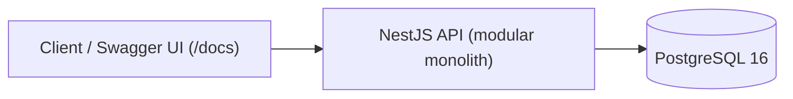

# TicketHub API (`In Progress` — Milestone M1)

An event ticketing and reservation API built with **NestJS**, **TypeORM**, and **PostgreSQL** as a pragmatic modular monolith.

> **Status:** Milestone M1 (Foundation & Walking Skeleton) implemented. Authentication (M2), Events & Ticket Tiers (M3), and Transactional Orders / Concurrency Control (M4) are planned next.

## Architecture (M1 Walking Skeleton)



- **Strict validation & config:** Zod schema validates all required environment variables at startup ([`src/config/env.schema.ts`](src/config/env.schema.ts)).
- **Consistent HTTP pipeline:** `X-Request-Id` correlation middleware, global `ValidationPipe` (`whitelist`, `forbidNonWhitelisted`, `transform`), and `GlobalExceptionFilter` (`{ statusCode, error, message, details?, requestId, timestamp }`).
- **Database migrations:** TypeORM runs with `synchronize: false`; schema changes go through explicit migrations in `src/database/migrations/`.
- **Health & API docs:** `GET /health` checks PostgreSQL connectivity (`SELECT 1`); Swagger UI is served at `/docs` (OpenAPI JSON at `/docs-json`).

See [`docs/architecture.md`](docs/architecture.md) for details.

## Quick Start (Docker Compose)

1. Copy the example environment file:

   ```bash
   cp .env.example .env
   ```

   *(If a local PostgreSQL instance already uses port `5432`, set `POSTGRES_PORT=5433` in `.env`.)*

2. Start PostgreSQL, run migrations, and start the API:

   ```bash
   docker compose up --build
   ```

3. Verify the running service:
   - Health check: `GET http://localhost:3000/health`
   - Swagger UI: `http://localhost:3000/docs`
   - OpenAPI spec: `http://localhost:3000/docs-json`

## Environment Variables

| Variable | Required | Default | Description |
|---|---|---|---|
| `NODE_ENV` | No | `development` | Runtime mode (`development`, `test`, `production`) |
| `PORT` | No | `3000` | HTTP server port |
| `DATABASE_URL` | **Yes** | — | PostgreSQL connection URL (`postgres://` or `postgresql://`) |
| `DB_SSL` | No | `false` | Enable SSL for managed PostgreSQL connections |
| `DB_LOGGING` | No | `false` | Enable TypeORM SQL query logging |
| `DB_POOL_MAX` | No | `10` | Maximum PostgreSQL connection pool size (`1`–`100`) |
| `SWAGGER_ENABLED` | No | `true` | Enable Swagger UI at `/docs` |
| `POSTGRES_USER` | Compose | `tickethub` | Postgres container user |
| `POSTGRES_PASSWORD` | Compose | `tickethub_dev_password` | Postgres container password |
| `POSTGRES_DB` | Compose | `tickethub` | Postgres container database name |
| `POSTGRES_PORT` | Compose | `5432` | Host port mapped to container `5432` |

## Local Development & Migrations

```bash
# Install dependencies
npm install

# Run pending migrations
npm run migration:run

# Inspect migration status
npm run migration:show

# Revert the last migration
npm run migration:revert

# Generate a new migration after adding/updating entities
npm run migration:generate -- src/database/migrations/DescribeChange

# Start API in watch mode
npm run start:dev
```

## Testing & Quality Checks

```bash
# Lint, formatting, and strict TypeScript check
npm run lint
npm run format:check
npm run typecheck

# Unit tests (config validation, exception filter, health service)
npm test

# E2E tests (validation suite runs DB-free; health suite requires PostgreSQL)
npm run test:e2e

# Production build
npm run build
```

## CI Pipeline

GitHub Actions ([`.github/workflows/ci.yml`](.github/workflows/ci.yml)) runs on every push and pull request targeting `main`/`master`:

1. `npm ci`
2. `npm run lint` -> `npm run format:check` -> `npm run typecheck`
3. `npm test`
4. `npm run migration:run` against a `postgres:16-alpine` service container
5. `npm run test:e2e`
6. `npm run build`
7. Multi-stage `Dockerfile` build check

## Deployment (Render Blueprint / Docker)

The repository includes [`render.yaml`](render.yaml) to provision a managed PostgreSQL instance (`tickethub-db`) and Docker web service (`tickethub-api`):

- Runs `npm run migration:run:prod` as `preDeployCommand` before traffic shifts.
- Enables `DB_SSL=true` and configures `/health` as `healthCheckPath`.
- For any container host, build [`Dockerfile`](Dockerfile), set `DATABASE_URL` (and `DB_SSL=true` if required by your managed database), run `npm run migration:run:prod`, and start `node dist/main.js`.
