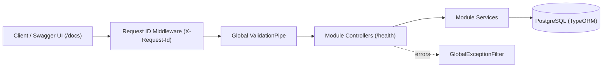

# TicketHub Architecture (Milestone M1)

## Overview

TicketHub is structured as a pragmatic NestJS modular monolith backed by PostgreSQL:



## Module & Layer Rules

- **First release target modules:** `health` (M1), `auth` & `users` (M2), `events` (M3), `orders` (M4).
- **Inside each module:** `controller` (HTTP transport + Swagger annotations) -> `service` (business logic + transactions) -> `repository` (TypeORM).
- **Cross-module communication:** modules communicate through exported services, never by importing another module's repositories.

## Request Lifecycle & Error Contract

1. **Correlation ID (`requestIdMiddleware`)**
   - Registered on the Express app in [`src/app.setup.ts`](../src/app.setup.ts) before Nest routes.
   - Reuses a safe client `X-Request-Id` (`^[a-zA-Z0-9_-]{1,64}$`) or generates a UUID v4, attaching it to `req.requestId` and echoing `X-Request-Id` on every response.
2. **Input Validation (`ValidationPipe`)**
   - Configured globally with `whitelist: true`, `forbidNonWhitelisted: true`, and `transform: true`.
   - Formats constraint violations into `{ field, messages }` entries inside `BadRequestException`.
3. **Unified Error Responses (`GlobalExceptionFilter`)**
   - Every HTTP or unhandled error returns:
     ```json
     {
       "statusCode": 400,
       "error": "Bad Request",
       "message": "Validation failed",
       "details": [{ "field": "title", "messages": ["title should not be empty"] }],
       "requestId": "7f2e7f48-2b6e-4c4e-9df2-6d9d2e69c5d1",
       "timestamp": "2026-11-24T02:45:00.000Z"
     }
     ```
   - `details` is omitted when not applicable.
   - Non-`HttpException` errors log internally with `requestId` and return a generic `500 Internal server error` without leaking stack traces or secrets.

## Configuration & Fail-Fast Startup

- Environment variables are validated at boot in [`src/config/env.schema.ts`](../src/config/env.schema.ts) using Zod (`ConfigModule.forRoot({ validate: validateEnv })`).
- Missing `DATABASE_URL` or invalid values abort process startup immediately with field-level diagnostics.

## Database & Migrations

- TypeORM runs with `synchronize: false` and `migrationsRun: false` ([`src/database/database-options.ts`](../src/database/database-options.ts)).
- Schema changes use explicit migrations in `src/database/migrations/`, executed via `npm run migration:run` in development or `npm run migration:run:prod` during release/container startup.
- Milestone M1 ships [`1700000000000-EnableCitextExtension.ts`](../src/database/migrations/1700000000000-EnableCitextExtension.ts) to enable `citext` and `pgcrypto` ahead of Milestone M2.
