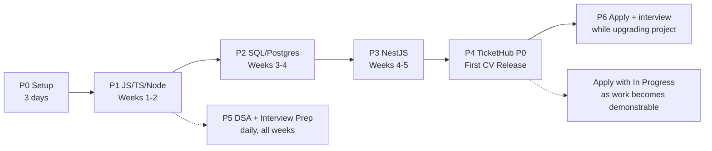

# Junior Node.js / NestJS Backend Developer: Job-Ready Roadmap

**Stack:** Node.js · TypeScript · NestJS · PostgreSQL (+ Redis and Docker where they're justified)
**Time:** 8–10 h/day, 6 days/week, 1 full rest day
**Target:** prepare application materials now, begin applying with an accurate TicketHub **In Progress** entry, and increase application effort at the First CV Release while continuing to improve the project.

> [!IMPORTANT]
> **The core strategy:** build deep fundamentals (JS async, SQL, HTTP), complete a focused TicketHub release that proves transactions, concurrency, security, tests, and deployment, then start applying while improving it. Be able to explain every implemented decision out loud.

---

## Table of Contents
1. [What Hiring Managers Actually Evaluate](#1-what-hiring-managers-actually-evaluate)
2. [Priorities by Hiring Impact (and What to Skip)](#2-priorities-by-hiring-impact-and-what-to-skip)
3. [Timeline at a Glance](#3-timeline-at-a-glance)
4. [Daily and Weekly Operating System](#4-daily-and-weekly-operating-system)
5. [AI Strategy: Use It Without Depending on It](#5-ai-strategy-use-it-without-depending-on-it)
6. [Phase 0: Setup and Baseline](#6-phase-0-setup-and-baseline-3-days)
7. [Phase 1: JavaScript, TypeScript, Node.js, HTTP](#7-phase-1-javascript-typescript-nodejs-http-2-weeks)
8. [Phase 2: SQL and PostgreSQL](#8-phase-2-sql-and-postgresql-8-days)
9. [Phase 3: NestJS Core](#9-phase-3-nestjs-core-10-days)
10. [Phase 4: Portfolio Project, TicketHub](phase_4_portfolio_project_tickethub.md)
11. [Phase 5: Interview Preparation](#phase-5-interview-preparation)
12. [Phase 6: Job Search Execution](#phase-6-job-search-execution)
13. [Red Flags That Get Juniors Rejected](#13-red-flags-that-get-juniors-rejected)
14. [Final Job-Ready Checklist](#14-final-job-ready-checklist)
15. [Minimal Resource List](#15-minimal-resource-list)

---

## 1. What Hiring Managers Actually Evaluate

This is roughly how I score a junior backend candidate:

| Area | Weight | What I'm really checking |
|---|---|---|
| **JS/TS and async fundamentals** | 20% | Event loop, promises, error handling, closures. Can they predict what async code prints? |
| **Can build a clean API** | 20% | Live-code or take-home a CRUD API with validation, errors, structure, and tests |
| **SQL and data modeling** | 15% | Joins, aggregation, indexes, transactions. Can they design a schema from requirements? |
| **Project depth and ownership** | 15% | Did they solve real problems? Can they defend their trade-offs? Did they write it themselves? |
| **Communication** | 15% | Can they explain clearly, think aloud, and admit what they don't know? |
| **Problem solving (DSA)** | 10% | Easy/medium problems, mostly in online assessments |
| **Engineering hygiene** | 5% | Git, tests, Docker, README, CI |

**What this means for you:** fundamentals + building + SQL + explaining make up about 70% of the decision. Fancy tech makes up roughly 0%.

---

## 2. Priorities by Hiring Impact (and What to Skip)

| Tier | Topics | Rule |
|---|---|---|
| **S: Must master** | JS async/event loop, TypeScript basics, REST/HTTP, NestJS core (modules, DI, pipes, guards, interceptors), SQL (joins, group by, indexes), transactions, JWT auth, validation, error handling, unit + e2e tests, Git | Interview-proof depth. You can explain each without notes. |
| **A: Must be solid** | Isolation levels and locking, Docker + Compose, CI (GitHub Actions), deployment, OWASP API security basics | Understand the ideas; implement the focused TicketHub release first |
| **Post-release project upgrades** | Idempotency, Redis caching, background jobs, query optimization, load testing | Build while applying; these do not block the first CV release |
| **B: Awareness** | Horizontal scaling, load balancing, message queues in general, CAP, microservices vs monolith trade-offs, observability | Be able to talk about them for 2–3 minutes. Don't build them. |
| **Skip for now** | Kubernetes, microservices, Kafka/RabbitMQ, GraphQL, MongoDB, CQRS/event sourcing, heavy DDD, AWS certifications, multiple ORMs, frontend frameworks, Go/Rust | They take a lot of time and rarely decide a junior hire. Learn them on the job. |

**Decisions made for you (so you don't waste days choosing):**
- **ORM:** **TypeORM**. It's the most common choice in NestJS job posts, and it supports QueryRunner transactions and pessimistic locks natively. Learn raw SQL deeply too; interviewers test SQL, not ORM APIs. (Prisma is fine as well, but pick one and stick with it.)
- **Validation:** `class-validator` + `class-transformer` (the NestJS standard).
- **Config validation:** Joi or Zod.
- **Logging:** `nestjs-pino`.
- **Tests:** Jest + Supertest + Testcontainers (real Postgres).
- **Queue/cache:** defer Redis + BullMQ until after the first TicketHub release; PostgreSQL is enough for the initial scope.
- **HTTP adapter:** default Express.
- **Node:** current Active LTS (check nodejs.org).
- **OS on Windows:** **WSL2 (Ubuntu) + Docker Desktop**. Do all development inside WSL2.

---

## 3. Timeline at a Glance

| Week | Phase | Focus | Key Deliverable |
|---|---|---|---|
| 0 (3 days) | Phase 0 | Environment, baseline test, accounts | Dev environment ready, baseline self-score |
| 1–2 | Phase 1 | JS/TS deep dive, Node internals, HTTP | `js-fundamentals` repo (utilities + tests), raw Node HTTP server |
| 3 to mid-4 | Phase 2 | SQL, PostgreSQL, indexes, transactions, locks | `sql-lab` repo: exercises, index report, concurrency lab |
| Mid-4 to 5 | Phase 3 | NestJS core + throwaway practice API | `task-manager-api` with auth, validation, tests |
| 6+ | Phase 4 | **TicketHub** first CV release, then improve while applying | P0 checklist complete: core API, transactional inventory, tests, deployed demo, README |
| 1–12+ | Phase 5 | DSA (daily), theory flashcards, mocks | ~100 problems, question bank mastered |
| Now, alongside Phase 4 | Phase 6 prep | CV, LinkedIn, GitHub profile and targeted applications | Start with suitable roles when materials and meaningful project work are ready; label unfinished work accurately |
| After first release | Phase 6 full | More applications, interview practice, and TicketHub upgrades | Increase application effort while building P1 features |

> [!NOTE]
> **Honest expectations:** the timeline depends on your starting point and local market. Prepare your CV/profile alongside the project and don't wait for every checklist item before applying. Mark TicketHub **In Progress** until the release is complete, then increase application effort while continuing to ship improvements.

---

## 4. Daily and Weekly Operating System

### Daily schedule templates

**Learning phases (Phases 1–3):**
| Block | Time | Activity |
|---|---|---|
| 1 | 3.0 h | Deep study + hands-on exercises (docs first, no AI generation) |
| 2 | 1.0 h | DSA: 1–2 problems, timed |
| 3 | 3.0 h | Build tasks for the phase |
| 4 | 1.0 h | SQL drills / theory Q&A / flashcards (Anki) |
| 5 | 0.5 h | Daily log: "What I learned, what confused me." Record a 2-minute spoken explanation of one concept. |

**TicketHub/job-search phase (8 h/day):** 4 h building TicketHub · 2 h backend study · 1 h coding/interview practice · 1 h CV/GitHub/applications. Once the First CV Release is ready, reduce new feature work and increase time for applications and interviews.

### Weekly rhythm
- **Mon–Sat:** execute the plan.
- **Saturday evening (1 h):** weekly review. Check the phase acceptance criteria, update the plan, and push everything to GitHub.
- **One AI-free day per week** (for example, Wednesday): no AI at all. This builds interview-condition muscle.
- **Sunday:** fully off. Burnout will slow you down more than any skill gap.

### Non-negotiable habits
1. **Commit daily** with Conventional Commits (`feat:`, `fix:`, `test:`, `refactor:`).
2. **Anki flashcards:** every new concept or interview question becomes a card. 15 min/day.
3. **Explain out loud.** Interviews are verbal. If you can't explain a concept in 2 minutes, you don't own it yet.
4. **Docs before tutorials.** Use video only when you're stuck for more than 30 minutes.

---

## 5. AI Strategy: Use It Without Depending on It

Interviews, live coding, and most online assessments **don't allow AI**. But employers *do* expect you to be productive with AI on the job. You need both skills.

### The rules
| Rule | Detail |
|---|---|
| **30-minute struggle rule** | Try for at least 30 minutes (docs, debugger, reasoning) before asking AI. Write down your hypothesis first. |
| **Tutor, not ghostwriter** | In Phases 1–3, AI may **explain, quiz, and review**, but never write the solution. |
| **You write v1** | In Phase 4, you write the first implementation of every core feature. AI then reviews it. |
| **Explain-or-delete** | Any AI-suggested line you can't explain line by line gets deleted and rewritten by you. |
| **No AI for DSA** | Ever. Look at hints and solutions only after 40 minutes, then re-solve from scratch 3 days later. |
| **AI-free day** | One day per week with zero AI. |
| **Boilerplate is fine** | After you've hand-written something 2–3 times (a DTO, a Dockerfile, a test skeleton), AI may generate it. |

### High-value AI uses (with prompts)
- **Socratic tutor:** *"I'm learning PostgreSQL isolation levels. Don't explain yet. Ask me 5 questions of increasing difficulty, one at a time, and correct my answers."*
- **Code reviewer:** *"Act as a strict senior NestJS reviewer. Review this service for bugs, race conditions, security issues, and naming. Don't rewrite it; list issues by severity with reasoning."*
- **Mock interviewer:** *"You're interviewing me for a Junior Node.js/NestJS role. Ask me one question at a time on [topic]. After each answer, score it 1–5 and tell me what a strong answer would include."*
- **Test-case generator:** *"List edge cases I should test for this order-creation endpoint. Don't write code."*
- **Error explainer (after forming a hypothesis):** *"I think this deadlock happens because X. Here's the log. Is my reasoning correct?"*
- **Spec writer for practice:** *"Give me a realistic 4-hour backend take-home assignment for a junior NestJS role, with requirements and evaluation criteria."*

### Banned uses
- Generating whole modules or features you haven't designed yourself
- Copy-pasting code into the project without understanding it
- Writing your README "engineering decisions" section (interviewers will probe it, and you need to own every word)
- Solving assessment problems during real applications (this is dishonest and easy to detect in follow-up rounds)

---

## 6. Phase 0: Setup and Baseline (3 days)

### Tasks
- [ ] Install WSL2 (Ubuntu), Docker Desktop (WSL2 backend), Node LTS via `nvm`, VS Code + WSL extension, Git
- [ ] Tools: `psql` + DBeaver (or pgAdmin), Bruno/Postman/HTTPie, Anki
- [ ] Set up a GitHub profile (photo, bio, profile README placeholder) and SSH keys
- [ ] Create a LinkedIn profile skeleton (you'll finish it in week 8)
- [ ] Create a NeetCode/LeetCode account and a Notion/Markdown "learning log"
- [ ] **Baseline self-assessment:** rate yourself 0–3 on every Tier S/A topic from Section 2. Save it, and re-score at the end of each phase.
- [ ] Solve 5 easy LeetCode problems to calibrate your DSA level

### Acceptance criteria
- `docker run hello-world` works inside WSL2
- `node -v`, `psql --version`, and `git` all work in WSL2
- Baseline scores are written down; the weakest areas are flagged

---

## 7. Phase 1: JavaScript, TypeScript, Node.js, HTTP (2 weeks)

### Topics (in priority order)

**JavaScript (week 1)**
- Types and coercion, `==` vs `===`, truthiness
- Scope, hoisting, TDZ, **closures**
- `this` binding rules, arrow vs regular functions, `call/apply/bind`
- Prototypes, classes, inheritance
- **Async:** callbacks, then promises, then async/await; error propagation; `Promise.all/allSettled/race/any`
- **Event loop:** call stack, microtasks vs macrotasks, Node phases (timers, pending, poll, check, close), `process.nextTick` vs `setImmediate` vs `setTimeout(0)`
- ES Modules vs CommonJS
- Iterators/generators (light)

**TypeScript (week 1–2)**
- `strict` mode, `type` vs `interface`, unions/intersections, literal types
- Narrowing and type guards, `unknown` vs `any`, `never`
- **Generics**, constraints, utility types (`Partial`, `Pick`, `Omit`, `Record`, `ReturnType`, `Awaited`)
- Enums vs union literals (and why many teams prefer unions)
- Decorators (conceptually; NestJS relies on them)

**Node.js (week 2)**
- Module system, `package.json`, semver, lockfiles, `npm ci`
- `fs/promises`, **streams and backpressure**, Buffer
- `EventEmitter`
- `http` module (build a server with no framework)
- CPU-bound vs I/O-bound work; `worker_threads` vs `child_process` vs cluster (concepts)
- Env vars, process signals, **graceful shutdown**
- Unhandled rejections and uncaught exceptions

**HTTP and REST (week 2)**
- Methods and **idempotency**, status codes (200, 201, 204, 400, 401, 403, 404, 409, 422, 429, 500)
- Headers, cookies (HttpOnly, Secure, SameSite), CORS, caching headers (ETag, Cache-Control)
- Resource naming, pagination, filtering, versioning, consistent error format

### Practical coding tasks (repo: `js-fundamentals`, all with Jest tests)
1. Implement `myPromiseAll`, `myPromiseAllSettled`, `promisify`
2. `retry(fn, { retries, backoff })` with exponential backoff + jitter
3. `mapWithConcurrency(items, limit, fn)` (a p-limit equivalent; very common in interviews)
4. `debounce`, `throttle`, `memoize` with TTL
5. A typed `EventEmitter<Events>` using TS generics
6. `LRUCache<K, V>` with O(1) get/put
7. Token-bucket rate limiter class
8. **20 "predict the output" event loop puzzles.** Write them yourself, predict, then run.
9. **Raw Node HTTP server (no Express):** an in-memory JSON CRUD for `notes` with routing, body parsing, validation, proper status codes, a central error handler, and graceful shutdown on SIGTERM
10. **Stream processor:** read a 1 GB CSV (generate it), aggregate stats, and write the result while keeping memory flat. Use `pipeline()`.
11. Type utilities: `Result<T, E>`, `DeepPartial<T>`, a typed `groupBy`

### Deliverables
- `js-fundamentals` repo: 11 tasks, tests passing, README listing what each demonstrates
- About 60 Anki cards
- About 15 easy DSA problems

### Acceptance criteria
- [ ] All utilities pass your own tests, including edge cases (empty input, rejections, limit = 1)
- [ ] You predict at least 18 of 20 event loop puzzles correctly
- [ ] You can explain the event loop **out loud in 3 minutes**, with a whiteboard sketch
- [ ] The stream processor handles 1 GB with less than 100 MB RSS (measure with `process.memoryUsage()`)
- [ ] You can rewrite `mapWithConcurrency` from scratch in under 20 minutes without help
- [ ] You can explain when to use 401 vs 403, 400 vs 422, and 409

---

## 8. Phase 2: SQL and PostgreSQL (8 days)

> [!TIP]
> SQL is where most junior candidates are weakest, and many companies test it live. Strong SQL is one of the fastest ways to stand out.

### Topics
- **Modeling:** entities and relationships, 1NF–3NF, when to denormalize
- **DDL:** data types (`uuid`, `timestamptz`, `numeric`/integer minor units for money, `jsonb`, `citext`), constraints (PK, FK + `ON DELETE`, `UNIQUE`, `CHECK`, `NOT NULL`)
- **Queries:** joins (inner/left/anti-join), `GROUP BY`/`HAVING`, subqueries, **CTEs**, **window functions** (`ROW_NUMBER`, `RANK`, `LAG`, `SUM() OVER`), `UPSERT` (`ON CONFLICT`), `RETURNING`
- **Indexes:** B-tree, composite (column order matters), partial, unique, covering (`INCLUDE`), GIN (jsonb, full-text); when indexes hurt
- **`EXPLAIN ANALYZE`:** Seq Scan vs Index Scan vs Bitmap; Nested Loop vs Hash Join; row estimates
- **Transactions:** ACID; isolation levels (Read Committed, Repeatable Read, Serializable); anomalies (dirty read, non-repeatable read, phantom, **lost update**, write skew); MVCC basics
- **Locking:** `SELECT ... FOR UPDATE`, `SKIP LOCKED`, `NOWAIT`, deadlocks + lock ordering, advisory locks; optimistic locking (version column)
- **Operations:** connection pooling, migrations, N+1 problem

### Practical tasks (repo: `sql-lab`)
1. **pgexercises.com:** complete all sections
2. **LeetCode "SQL 50":** at least 35 problems
3. **Must-know query patterns:** write each from memory and save it in `patterns.sql`:
   - Top-N per group (window function)
   - Second-highest value
   - Find duplicates
   - Users with no orders (anti-join)
   - Running totals / month-over-month revenue
   - Retention/cohort (simple)
4. **Schema design:** from a written spec (for example, a "library with members, books, copies, loans, reservations"), produce an ERD + DDL with every constraint justified
5. **Index lab:** seed 1M+ rows with `generate_series`, write 5 slow queries, fix them with indexes, and document `EXPLAIN ANALYZE` before and after in `index-report.md`
6. **Concurrency lab (two `psql` sessions):**
   - Reproduce a **lost update** on a balance
   - Fix it in 3 ways: atomic `UPDATE ... SET x = x - 1 WHERE x >= 1`, `SELECT ... FOR UPDATE`, and `SERIALIZABLE` + retry
   - Reproduce a **deadlock**, read the error, then fix it with consistent lock ordering
   - Use `FOR UPDATE SKIP LOCKED` to build a simple job-queue table
7. **Node + `pg` driver:** pool, parameterized queries, a manual transaction (`BEGIN`/`COMMIT`/`ROLLBACK` in `try/finally` with `client.release()`). Demonstrate **SQL injection** with string concatenation, then fix it.

### Deliverables
- `sql-lab` repo containing `patterns.sql`, `schema-design/`, `index-report.md`, `concurrency-lab.md`, and `node-pg-demo/`

### Acceptance criteria
- [ ] Write a top-N-per-group query in under 10 minutes from a blank screen
- [ ] Explain all isolation levels and which anomalies each prevents (in Postgres specifically)
- [ ] Demonstrate a lost update live and explain 3 fixes with their trade-offs
- [ ] The index report shows at least one 10x+ improvement, with plans explained in your own words
- [ ] You can explain why composite index `(a, b)` helps `WHERE a = ?` but not `WHERE b = ?`

---

## 9. Phase 3: NestJS Core (10 days)

### Topics
- Modules, providers, **dependency injection**, injection scopes, custom providers (`useClass`/`useValue`/`useFactory`)
- Controllers, DTOs, global `ValidationPipe` (`whitelist`, `forbidNonWhitelisted`, `transform`)
- **Request lifecycle:** middleware, then guards, then interceptors (before), then pipes, then the handler, then interceptors (after), then exception filters
- Guards (auth/roles), interceptors (logging, serialization, timeouts), exception filters, custom decorators
- `ConfigModule` with schema validation (fail fast on bad env)
- TypeORM: entities, relations, repositories, QueryBuilder, migrations (`synchronize: false`), `DataSource.transaction()` / `QueryRunner`
- Swagger (`@nestjs/swagger`)
- Testing: `Test.createTestingModule`, overriding providers, e2e with Supertest
- Lifecycle hooks, `enableShutdownHooks()`
- Circular dependencies (`forwardRef`) and why they signal bad design

### Practical tasks
1. **Throwaway practice API: `task-manager-api` (about 6 days).** Users, projects, tasks. Include JWT login, role guard, DTO validation, pagination + filtering, a global error filter, Swagger, migrations, unit tests for services, and e2e tests for 3 flows. *This is where you make mistakes, so TicketHub starts clean.*
2. **Lifecycle experiment:** add a log line to a middleware, guard, interceptor, pipe, and filter, then verify the execution order.
3. **Timed CRUD drill (repeat 3 times, different domains: books, products, employees):** a new module with entity, migration, DTOs, validation, service, controller, pagination, and one e2e test. **Target: under 60 minutes, no AI.** (This is direct live-coding prep.)

### Deliverables
- `task-manager-api` repo (can stay private or public; it's not your showcase)
- 3 timed drill repos or branches with recorded times

### Acceptance criteria
- [ ] Draw the request lifecycle from memory
- [ ] Complete the timed CRUD drill in under 60 minutes without AI or docs
- [ ] Explain how Nest's DI container resolves providers and what happens when a provider isn't exported
- [ ] Explain the difference between unit tests (mocked repositories) and e2e tests (real HTTP + DB), and when to use each

---

## Phase 4: Portfolio Project, TicketHub

Nội dung chi tiết được tách sang [file Phase 4: Portfolio Project, TicketHub](phase_4_portfolio_project_tickethub.md).

## Phase 5: Interview Preparation

### 11.1 Junior interview formats you'll face
| Format | How to prepare |
|---|---|
| **Online assessment** (HackerRank/Codility) | DSA plan (11.2) + SQL patterns |
| **Recruiter/HR screen** | Pitch, motivation, salary range, availability (11.8) |
| **Technical Q&A** | Question bank (11.6) + Anki |
| **Live coding: JS** | Utilities list (11.3) + output prediction |
| **Live coding: API** | Timed NestJS CRUD drills (11.4) |
| **Live SQL** | `patterns.sql` drills (11.4) |
| **Take-home** | Simulations (11.5) |
| **Project deep dive** | Section 11.7 |
| **Behavioral** | STAR stories (11.8) |

### 11.2 DSA plan (in JS/TS, about 100 problems total)
| Weeks | Daily | Focus | Cumulative |
|---|---|---|---|
| 1–5 | 1 h | Easy: arrays, strings, hash maps, two pointers, stack | ~35 |
| 6–11 | 1–1.5 h | Easy/medium: sliding window, binary search, linked list, trees (BFS/DFS), recursion, intervals, heap basics | ~85 |
| 12+ | 1.5–2 h | Timed mediums (25 min), mixed review, re-solve failures; a few graphs (BFS) and 1D DP | ~110 |

Use the **NeetCode 150 list as your source** (skip hard DP and advanced graphs). The rule: if you couldn't solve a problem, re-solve it from scratch 3 days later and again 1 week later.

### 11.3 JS live-coding drills (must do each in 15–25 min, no help)
`Promise.all` · `promisify` · `retry` with backoff · concurrency limiter · `debounce`/`throttle` · `memoize` · `EventEmitter` · `LRUCache` · deep clone · flatten array/object · `groupBy` · token-bucket rate limiter · async queue with max concurrency · "predict the output" (event loop, closures in loops, `this`)

### 11.4 Practical drills
- **NestJS CRUD in 45–60 min:** 5 different domains. Entity + migration + validation + pagination + error handling + one e2e test.
- **SQL in 10 min each:** top-N per group, anti-join, running totals, duplicates, month-over-month growth, second highest.
- **Debugging drill:** take a working project, have AI (or a friend) inject 3 bugs (N+1, a missing `await`, wrong transaction scope), then find them with logs and the debugger.

### 11.5 Take-home simulations (do 2–3 in weeks 10–12, strictly timed)
1. **Wallet service (6 h):** deposit, withdraw, transfer; no negative balances under concurrency; paginated transaction history; idempotent transfers.
2. **URL shortener (5 h):** create, redirect, click analytics, rate limiting, expiration, caching.
3. **Library loans (4 h):** borrow/return, reservation queue, overdue fees, role-based access.

**Self-grading rubric:** runs with one command · tests for core logic · validation + consistent errors · clean module structure · README with assumptions and trade-offs · meaningful commit history · finished on time (cut scope deliberately and document what you cut).

### 11.6 Technical question bank (put all of these in Anki)

**JavaScript / Node.js**
- Explain the event loop and its phases. `process.nextTick` vs `setImmediate` vs `setTimeout(0)`?
- Microtasks vs macrotasks. What does this snippet print? (Practice 20+ variants.)
- How does Node handle concurrency on a single thread? When does it block?
- How do you handle CPU-heavy work in Node? (worker threads, queues, offloading)
- `Promise.all` vs `allSettled` vs `race` vs `any`
- What happens on an unhandled promise rejection?
- Streams and backpressure: why use `pipeline()`?
- Closures: give a practical use. What's the classic `var`-in-loop bug?
- CommonJS vs ESM
- How do you implement graceful shutdown?
- What is `libuv`? What uses the thread pool?
- Memory leaks in Node: common causes and how you'd detect one

**TypeScript**
- `type` vs `interface` · `unknown` vs `any` vs `never` · generics with constraints · utility types · type guards/narrowing · why enums are sometimes avoided

**NestJS**
- What is DI and why use it? How does Nest resolve dependencies?
- Request lifecycle order (middleware, guards, interceptors, pipes, filters)
- Guard vs middleware vs interceptor: when do you use each?
- How does `ValidationPipe` work? What do `whitelist` and `transform` do?
- Provider scopes (default/request/transient) and their performance implications
- How do you handle circular dependencies?
- How do you structure modules in a growing app?
- How do you test a service that depends on a repository?
- How do you run code in a transaction across multiple repositories in TypeORM?
- Exception filters: how do you build a consistent error format?

**HTTP / REST / API design**
- Idempotent methods? PUT vs PATCH? POST idempotency (keys)?
- 401 vs 403 · 400 vs 422 · when to use 409
- Offset vs cursor pagination
- API versioning strategies
- What is CORS, and why does it exist?
- How would you design an API for [resource]?
- ETags and conditional requests

**Databases / SQL**
- Normalization: why and when to denormalize
- How do indexes work (B-tree)? When do they *not* help? Composite index column order?
- How do you find and fix a slow query?
- What is the N+1 problem? How do you fix it?
- `INNER` vs `LEFT JOIN` · `WHERE` vs `HAVING` · CTE vs subquery
- Window functions: give an example
- SQL injection and parameterized queries
- Soft delete trade-offs
- Connection pooling: why, and what happens if the pool is too small or too big?
- UUID vs serial IDs
- SQL vs NoSQL: when would you choose each?

**Transactions / concurrency**
- ACID, explained with an example
- Isolation levels and anomalies; Postgres's default level
- Lost update: how do you prevent it? (three ways)
- Optimistic vs pessimistic locking: trade-offs
- What is a deadlock? How do you prevent and handle one?
- `SELECT FOR UPDATE SKIP LOCKED`: use case?
- How do you prevent double-charging a customer? (idempotency)
- How do you keep the DB and a message queue consistent? (outbox, at a conceptual level)

**Auth / security**
- Authentication vs authorization
- How does JWT work? Its structure? Why can't you revoke it, and what do you do about it?
- Sessions vs JWT trade-offs
- Refresh token rotation and reuse detection
- Hashing vs encryption; why bcrypt/argon2 and not SHA-256?
- Where do you store tokens on the client? (XSS vs CSRF)
- OWASP API Top 10: explain BOLA/IDOR, mass assignment, broken auth
- How do you rate-limit, and where?
- How do you verify a webhook is genuine?
- How do you manage secrets?

**Performance / scaling (awareness level)**
- How would you scale this API to 10x traffic?
- Caching strategies and invalidation; what can go wrong (stampede, stale data)?
- Stateless services and horizontal scaling
- Vertical vs horizontal scaling; read replicas
- What do you monitor in production? (latency p95/p99, error rate, saturation)
- Why use a queue? When is it overkill?

**Testing**
- Unit vs integration vs e2e; the test pyramid
- Mocks vs real dependencies; why test against a real Postgres?
- How do you test concurrency?
- What makes a test flaky?

**Docker / deployment**
- Image vs container · multi-stage builds · why run as non-root
- What does Docker Compose solve?
- How do you run DB migrations safely in deployment?
- Environment config across dev/staging/prod
- What does your CI pipeline do, and why in that order?

**Mini system design (junior level, 20 min each):** URL shortener · rate limiter · notification service · ticket booking (your project) · file upload service. Cover requirements, API, schema, the main bottleneck, and one scaling step. Stop there.

### 11.7 Project deep-dive questions (rehearse until fluent)
1. Walk me through the architecture. Why a modular monolith?
2. How do you prevent overselling? What alternatives did you consider?
3. How do order creation and inventory reservation stay in one transaction?
4. What happens if the server crashes during order creation?
5. How does cancellation release inventory exactly once?
6. How do ownership checks prevent IDOR/BOLA?
7. How do your integration tests exercise real PostgreSQL behavior?
8. How do you test concurrency in CI without flakiness?
9. What would you improve next? (Discuss only as future work: idempotency, payments/webhooks, expiry jobs, caching.)
10. Which part was hardest, and how did you debug it?
11. How did you use AI while building this? (Be honest: tutor and reviewer, not author.)

### 11.8 Behavioral and HR prep
Prepare **6 STAR stories** (Situation, Task, Action, Result), drawn from university projects, TicketHub, and teamwork:
1. A hard bug you solved (the oversell race condition is perfect)
2. Learning something difficult quickly
3. A disagreement or conflict in a team
4. A mistake you made and what you changed afterward
5. Prioritizing under time pressure (a take-home where you cut scope)
6. Receiving critical feedback

Also prepare: a **60-second "tell me about yourself"** (CS degree → focused backend training → TicketHub highlights → why this company), "Why backend?", "Why us?", your salary range (research local junior ranges), and **2–3 smart questions** for each interviewer (for example: "What does onboarding look like for juniors?", "How are code reviews done?", "What would success look like in my first 90 days?").

### 11.9 Mock interview cadence
- **While building the first release:** 1 mock per week (AI interviewer for theory, a peer for live coding)
- **As interviews increase:** 2–3 mocks per week (peers, community mock platforms, a senior acquaintance)
- **Record yourself** and watch it back for filler words, rambling, and silent coding. Practice narrating your thinking.
- **After every real interview:** write a postmortem within 1 hour (questions asked, where you struggled), turn the questions into Anki cards, and add the gaps to next week's plan.

---

## Phase 6: Job Search Execution

### 12.1 Assets (prepare now; keep updating)
- **CV (1 page, ATS-friendly, no photo/graphics unless that's local custom):** Summary (2 lines), then Skills (only what you can defend), then **Projects (TicketHub first, with metrics)**, then Education, then other projects
- **LinkedIn:** headline "Backend Developer | Node.js · NestJS · TypeScript · PostgreSQL", an About section with the TicketHub pitch, a Featured link to the repo and live demo, Open to Work (visible to recruiters)
- **GitHub:** profile README, pinned repos (`tickethub`, `js-fundamentals`, `sql-lab`), green contribution history from daily commits

**CV wording:** while the project is unfinished, list it as **In Progress** and describe only completed work. After the First CV Release, use concise bullets such as:
- Built and deployed **TicketHub**, a NestJS + PostgreSQL ticketing API with JWT authentication, RBAC, event/ticket management, and ownership checks
- Prevented ticket overselling with transactional inventory reservations; verified with an integration test that sends 200 concurrent requests for capacity 50
- Added order cancellation that releases inventory in the same database transaction; covered critical flows with e2e tests and CI

Add performance numbers or advanced features only after implementing and measuring them yourself.

### 12.2 Where to apply
- **Outsourcing / software service companies:** often hire juniors in volume; NestJS is very common
- **Startups:** value practical building ability; your project matters most here
- **Product companies:** more DSA; apply in parallel
- **Fresher/graduate programs and internships:** don't skip them; many convert to full-time
- **Apply when you meet about 60% of requirements.** "1–2 years experience" posts often accept strong juniors.
- Channels: LinkedIn, local job boards, company career pages, developer communities (Discord/Facebook/Telegram groups in your region), meetups, and **referrals (the highest conversion rate)**

### 12.3 Pipeline targets
| Period | Applications/week | Outreach messages/week | Mocks/week |
|---|---|---|---|
| Before First CV Release | 3–5 suitable | 3–5 outreach messages | 1 |
| After First CV Release | 10–15 tailored | 5 | 1–2 |
| As interview pipeline grows | Adjust based on response rate and interview load | 5–10 | 2–3 |

Track everything in a spreadsheet: company, role, date, source, contact, stage, next action, and notes.

**Outreach template (to engineers or hiring managers, not only recruiters):**
> Hi [Name], I'm preparing for Junior Backend roles with Node.js/NestJS/PostgreSQL. I'm building TicketHub, a ticketing API, and have completed [specific finished features]. Here's the repo/demo: [link]. I'd value 10 minutes of your perspective on the team, or a referral if you think I'd be a fit. Thanks!

### 12.4 Funnel diagnostics: fix the weakest stage
| Symptom | Likely cause | Fix |
|---|---|---|
| Less than 5% response after 60+ applications | CV, targeting, or LinkedIn | Get a CV review, sharpen bullets, tailor keywords, apply to more junior-friendly companies |
| Screens but failing tech Q&A | Theory gaps / communication | More Anki + recorded mock answers |
| Failing live coding | Speed / nerves | Daily timed drills, narrating aloud |
| Failing take-homes | Scope, quality, or missing README | Use the 11.5 rubric; submit fewer features, better done |
| Failing final rounds | Behavioral / motivation | Rework STAR stories, research the company |

Always ask rejected-after-interview companies for feedback politely. Some will answer, and it's very valuable.

---

## 13. Red Flags That Get Juniors Rejected

- Tutorial-clone projects (to-do, blog, Netflix clone) with no hard problems
- **Can't explain their own code** (an obvious sign of AI-generated or copied code)
- No tests, or only the default `app.controller.spec.ts`
- Secrets or `.env` committed; `synchronize: true` in production
- One giant "initial commit"; no README; broken live demo
- Listing 25 technologies on the CV, then failing basic questions about them
- `any` everywhere; ignored errors; no input validation
- Saying "I don't know" and stopping. Instead, say "I'm not sure, but here's how I'd reason about it…"
- Badmouthing previous teams, or showing no curiosity about the company

---

## 14. Final Job-Ready Checklist

**Fundamentals**
- [ ] Explain the event loop and predict async output reliably
- [ ] Write 8+ JS utilities (concurrency limiter, retry, LRU, …) from scratch under time pressure
- [ ] Write top-N per group, anti-join, and window-function queries from a blank screen
- [ ] Explain isolation levels, locking, and three fixes for lost updates

**Building**
- [ ] Build a validated, tested NestJS CRUD module in under 60 minutes without AI
- [ ] Complete a 4–6 hour take-home to rubric standard

**Portfolio**
- [ ] TicketHub first CV release is live, with Swagger working
- [ ] CI is green; transactional overselling integration test and critical e2e flows pass
- [ ] README has architecture, ERD, setup, API examples, and test instructions
- [ ] 5-minute pitch + 20-minute deep dive cover implemented features accurately

**Interview**
- [ ] About 100 DSA problems solved; mediums in about 25 minutes
- [ ] Question bank answered aloud; Anki deck reviewed daily
- [ ] 6 STAR stories + a 60-second intro rehearsed
- [ ] 5+ mock interviews completed

**Job search**
- [ ] CV, LinkedIn, and GitHub polished
- [ ] Pipeline tracker running; weekly targets met; funnel reviewed weekly

---

## 15. Minimal Resource List

Use only these. Resist collecting courses.

| Topic | Resource |
|---|---|
| JavaScript | javascript.info (Parts 1–2) · Node.js docs: "The Node.js Event Loop" guide |
| TypeScript | Official TypeScript Handbook |
| Node.js | Official Node.js docs (streams, events, http, process) |
| NestJS | Official NestJS docs: Overview + Fundamentals + Techniques (Database, Validation, Config, Caching, Queues) + Security + Testing |
| SQL practice | pgexercises.com · SQLBolt (warm-up) · LeetCode SQL 50 |
| PostgreSQL | Official docs: chapters on Indexes, Concurrency Control (MVCC, isolation, locking), `EXPLAIN` · *Use The Index, Luke* (use-the-index-luke.com) |
| Transactions (deeper, optional) | *Designing Data-Intensive Applications*, Chapter 7 |
| Security | OWASP API Security Top 10 · OWASP Cheat Sheets (Authentication, JWT, Password Storage) |
| Testing | Jest docs · Testcontainers for Node docs · NestJS Testing docs |
| Docker / CI | Docker docs (multi-stage builds) · GitHub Actions docs |
| Load testing | k6 docs |
| DSA | NeetCode roadmap/videos (only after attempting a problem) |
| Reference map | roadmap.sh/backend (to check coverage, not as a curriculum) |

---

> [!TIP]
> **If you fall behind:** protect the First CV Release scope: transactions, overselling test, critical e2e tests, README, and a working deployment. Defer payments, queues, caching, load testing, and polish. Don't hold suitable applications until every release item is checked; show TicketHub as **In Progress** and state exactly what works.
