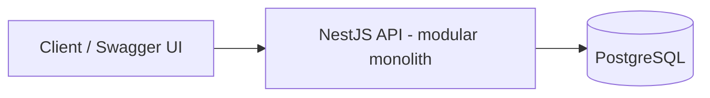
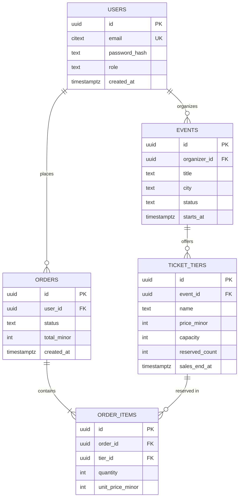
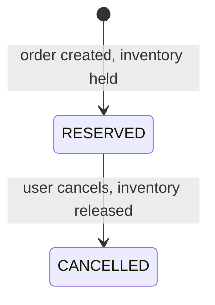
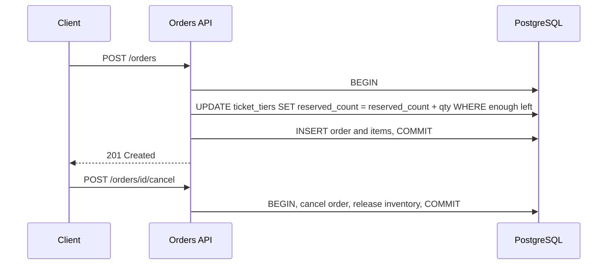

## Phase 4: Portfolio Project, TicketHub

### 10.1 Why this project

**TicketHub: an event ticketing and reservation API.** Build a focused version that proves core Junior Backend skills. Prepare your CV while building, apply with an **In Progress** project entry once you have meaningful working features, then increase application effort at the first release and keep improving it afterward.

It's not a to-do app or a blog. Ticketing **naturally requires** the problems interviewers care about:

| Real problem | Engineering skill demonstrated |
|---|---|
| 200 people try to buy the last 50 tickets | **Concurrency control**, preventing oversell |
| Order + inventory must stay consistent | **Transactions**, state machines |
| An order reserves the last tickets | **Transactions and concurrency control**, preventing oversell |
| A customer cancels an order | **Atomic inventory release** |
| Organizers must only edit their own events | **AuthZ / IDOR prevention** |

### 10.2 Scope

#### First CV Release (P0)

This is the target for the first complete portfolio release and a good point to increase application volume. You can begin applying earlier when your CV/profile are ready and TicketHub has meaningful working features; label it **In Progress** and describe only what is already done. Complete these five groups before calling the release finished:

1. **Foundation:** NestJS, TypeORM, PostgreSQL, Docker Compose, migrations, validation, Swagger with request/response examples.
2. **Authentication:** register, login, hashed passwords, JWT authentication, RBAC, and ownership checks.
3. **Events and tickets:** event CRUD, validation, publish/unpublish, ticket tiers, ownership rules, and database constraints.
4. **Orders and inventory:** PostgreSQL transaction, atomic ticket reservation, order items, cancellation, and inventory release in the same transaction.
5. **Testing and deployment:** integration and e2e tests, CI, a working deployed API, and README setup instructions.

**First CV Release checklist (9 checks):**
- [ ] Docker Compose starts NestJS and PostgreSQL; migrations run; validation and Swagger are configured
- [ ] Register/login, JWT, password hashing, RBAC, and ownership checks work
- [ ] Event CRUD and publish/unpublish work with validation
- [ ] Ticket tiers have database constraints for price and capacity
- [ ] Order creation reserves tickets transactionally and stores order items
- [ ] Order cancellation releases inventory transactionally
- [ ] Integration test: 200 concurrent requests for capacity 50 produce exactly 50 successful reservations
- [ ] E2E tests cover authentication, authorization, event, and order flows; CI runs them
- [ ] README documents architecture, ERD, setup, API examples, and test instructions; deployed API and Swagger are accessible

When the checklist is complete, mark the first release as done and increase your application effort. Before then, you can apply with TicketHub marked **In Progress**. Never claim unimplemented features or measured results.

#### Post-release backlog (P1)

Continue these while applying and preparing for interviews: idempotency, a payment provider and signed/deduplicated webhooks, BullMQ and automatic order expiration, Redis caching, query optimization, sales reports, k6 load tests, large seed datasets, OpenTelemetry, and advanced CI/CD. Keep cancellation and inventory release in P0; only automatic expiry is deferred.

**Out of scope (deliberately):** frontend, microservices, Kubernetes, real payment integration (abstracted behind an interface instead), seat maps, multi-currency.

**Daily time budget (8 hours):** 4 h building TicketHub, 2 h backend study, 1 h coding/interview practice, 1 h CV/GitHub/applications. Once First CV Release is reached, reduce new feature work and spend more time applying and practicing interviews.

### 10.3 Architecture: pragmatic modular monolith



**Architecture rules (avoid overengineering):**
- First release modules: `auth`, `users`, `events`, `orders`, `health`
- Inside each module: **controller (HTTP only), then service (business logic + transactions), then repository (TypeORM)**. No extra layers.
- Add interfaces at external boundaries when those integrations are introduced in post-release work.
- Modules talk through exported services, never through each other's repositories.
- Business rules live in services, and data invariants are **also enforced by DB constraints** (defense in depth).

### 10.4 Data model



**First release constraints:** `CHECK (reserved_count >= 0 AND reserved_count <= capacity)`, `CHECK (price_minor >= 0)`, plus foreign keys and unique email. Add webhook/idempotency/expiry tables and indexes only in the post-release milestones that need them.

### 10.5 API surface (core)

| Method | Path | Auth | Notes |
|---|---|---|---|
| POST | `/auth/register`, `/auth/login` | Public | Password hashing; JWT returned |
| GET | `/users/me` | Access | Confirms authenticated identity |
| POST/PATCH/DELETE | `/events`, `/events/:id` | ORGANIZER (owner) | Validated event CRUD |
| POST | `/events/:id/publish`, `/events/:id/unpublish` | ORGANIZER (owner) | Publish state transitions |
| POST/PATCH/DELETE | `/events/:id/tiers`, `/events/:id/tiers/:tierId` | ORGANIZER (owner) | Capacity and price constraints |
| GET | `/events`, `/events/:id` | Public | Basic listing and detail |
| POST | `/orders` | CUSTOMER | Transactional inventory reservation |
| GET | `/orders`, `/orders/:id` | CUSTOMER (owner) | Owner-scoped access |
| POST | `/orders/:id/cancel` | CUSTOMER (owner) | Cancels and releases inventory atomically |
| GET | `/health` | Public | Database status |

### 10.6 Order lifecycle



Automatic order expiration, payment, and refunds are post-release work.



### 10.7 Repository structure

```
tickethub/
├── src/
│   ├── main.ts
│   ├── app.module.ts
│   ├── config/                 # env schema + typed config
│   ├── common/                 # filters, interceptors, guards, decorators, pipes
│   ├── database/               # data-source.ts, migrations/, seeds/
│   └── modules/
│       ├── auth/  users/  events/  orders/
│       └── health/
├── test/
│   ├── integration/            # Testcontainers: repositories, transactions, concurrency
│   ├── e2e/                    # Supertest: full HTTP flows
├── docs/
│   ├── adr/                    # auth strategy, inventory concurrency
│   ├── architecture.md  order-state-machine.md
├── .github/workflows/          # ci.yml, deploy.yml
├── Dockerfile  docker-compose.yml  .env.example  README.md
```

Work like a professional: GitHub Issues for each task, a feature branch per issue, PRs (to yourself) with descriptions, merges only when CI is green.

---

### Milestone M1: Foundation and Walking Skeleton (4 days)

**Goal:** a reproducible local app with a deployed skeleton as early as practical. Keep the first release lean.

**Tasks**
- [ ] `nest new`, strict TS, ESLint + Prettier, Conventional Commits
- [ ] `ConfigModule` with Joi/Zod validation (the app refuses to start on invalid env)
- [ ] `docker-compose.yml`: api and postgres (with healthchecks and named volumes)
- [ ] TypeORM `DataSource`, migration scripts (`migration:generate/run/revert`), `synchronize: false`
- [ ] Global `ValidationPipe` (`whitelist`, `forbidNonWhitelisted`, `transform`)
- [ ] Global exception filter with a consistent error shape: `{ statusCode, error, message, details?, requestId, timestamp }`
- [ ] `/health` endpoint and Swagger at `/docs` with request/response examples
- [ ] GitHub Actions CI: install, then lint, then type-check, then unit tests, then e2e tests (Postgres service container), then Docker build
- [ ] Deploy the API with managed PostgreSQL or Docker Compose; run migrations as a release step

**Acceptance criteria**
- [ ] `git clone` → `cp .env.example .env` → `docker compose up` gives a healthy API in under 2 minutes
- [ ] Removing a required env var makes startup fail with a clear message
- [ ] The live URL `/health` returns database status; `/docs` loads
- [ ] CI runs on every PR and blocks merging on failure
- [ ] No secrets are committed

---

### Milestone M2: Authentication, Users, Authorization (5 days)

**Tasks**
- [ ] `users` table (`citext` email unique), **argon2id** password hashing
- [ ] Register / login with generic error messages (no user enumeration)
- [ ] Access token (JWT, about 15 min) with documented transport
- [ ] Global `JwtAuthGuard` with a `@Public()` decorator; `RolesGuard` with `@Roles()`
- [ ] **Ownership checks** in services (prevent IDOR/BOLA). Return 404 for others' resources (and know why).
- [ ] Response serialization: `password_hash` can **never** leak (use response DTOs)

**Tests**
- Unit: `AuthService` (hashing and token issuance) with mocked repositories
- E2E: register, login, access protected route
- E2E: CUSTOMER creating an event gets 403; user A reading user B's order gets 404

**Acceptance criteria**
- [ ] All tests above pass in CI
- [ ] Grepping logs for tokens or passwords finds nothing

**Interview talking points:** JWT basics; argon2 vs bcrypt; what RBAC and IDOR are and how you prevented them. Refresh-token rotation can be added after release.

---

### Milestone M3: Core Domain, Events and Ticket Tiers (4 days)

**Tasks**
- [ ] Event CRUD by the owning organizer; state machine DRAFT → PUBLISHED → CANCELLED (invalid transitions return 409)
- [ ] Ticket tiers: price in **integer minor units**, capacity, `reserved_count`, sales window
- [ ] DB `CHECK` constraints (capacity, price, reserved_count bounds)
- [ ] Public listing and event detail endpoints; add only the pagination the first release needs
- [ ] Swagger examples for all endpoints

**Acceptance criteria**
- [ ] An integration test proves the DB rejects `reserved_count > capacity` even when bypassing the service

**Interview talking points:** why not floats for money; how ownership checks and database constraints protect the domain.

---

### Milestone M4: Orders, Transactions, Inventory Concurrency (7 days), the centerpiece

> [!IMPORTANT]
> This is the key technical feature in the first CV release. Build it yourself and be able to explain every line.

**Tasks**
1. [ ] **Create order** (`POST /orders`) in a single transaction:
   - Validate the event is published and the tier is within its sales window
   - **Atomic conditional reservation** per tier:
     `UPDATE ticket_tiers SET reserved_count = reserved_count + $1 WHERE id = $2 AND reserved_count + $1 <= capacity RETURNING id`
     Zero rows affected means sold out (409 `SOLD_OUT`), so roll back the whole order
   - **Lock ordering:** process tiers sorted by id to avoid deadlocks in multi-tier orders
   - Insert the order and order items with price snapshots in the same transaction
2. [ ] **Cancel order:** owner only; transition state and release reserved inventory in the same transaction. Repeated cancellation must not release inventory twice.
3. [ ] Document the minimal order state machine in `docs/order-state-machine.md`

**Tests (integration/e2e against real Postgres)**
- [ ] **Oversell test:** capacity 50, 200 concurrent order requests → **exactly 50 succeed**, 150 return 409, `reserved_count = 50`

**Deliverables**
- **ADR-002 Inventory concurrency:** compare atomic update vs `SELECT FOR UPDATE` vs optimistic version vs `SERIALIZABLE`; explain why you chose what you chose

**Acceptance criteria**
- [ ] All concurrency tests are green in CI, repeatedly (run them 10 times locally; no flakiness)
- [ ] You can whiteboard the order flow and explain what happens if the process crashes at each step

**Interview story:** explain the overselling bug you reproduced, why the atomic conditional update and transaction fix it, how cancellation releases inventory exactly once, and what the 200-request integration test proves. Use only results you measured yourself.

---

### Post-release M5: Background Jobs, Caching, Performance (optional)

Do these while applying, after the First CV Release checklist is done. None of them blocks sending a CV.

**Tasks**
- [ ] **Notifications:** order-confirmation email job via an `EmailProvider` interface (console/log implementation; Mailpit in Compose is optional)
  - Retries with exponential backoff
  - Failed jobs retained for inspection
  - **Idempotent handlers** (a re-run doesn't send duplicates)
- [ ] **Caching:** cache-aside in Redis for `GET /events/:id` and the first listing page, with a TTL + explicit invalidation on update. **Don't cache live inventory** (or use a very short TTL), and document why.
- [ ] **Rate limiting:** global default + stricter limits on auth and order creation
- [ ] **Sales report endpoint:** revenue per tier per day, cumulative revenue (CTE + `SUM() OVER`)
- [ ] **Performance work:**
  - Seed 1M orders
  - Enable `pg_stat_statements` and find the top slow queries
  - Add composite/partial indexes
  - Fix **N+1** in order listing (joins / batched loading)
  - Tune pool size
- [ ] **k6 load tests:** (a) browse events at 200 VUs, (b) checkout spike. Record p50/p95/p99 + error rate **before and after** indexes and cache.

**Acceptance criteria**
- [ ] `docs/performance.md` has at least 3 before/after measurements with `EXPLAIN` plans and k6 summaries (real numbers only)
- [ ] A test proves an email job retries after 2 provider failures and succeeds exactly once
- [ ] Order listing runs a constant number of queries regardless of page size (assert via query logging or a counter)
- [ ] The cache is invalidated on event update (e2e test)

**Interview talking points:** cache-aside vs write-through; cache invalidation and stale data; how you found and fixed slow queries; what p95 means and why it matters more than the average.

---

### Post-release M6: Production Readiness, CI/CD, Security, Observability (optional)

The first release already needs working CI, a deployed API, safe configuration, validation, and authorization. Add these extra hardening steps over time; they are not a reason to delay applications.

**Tasks**
- [ ] **CD:** merging to `main` builds an image, pushes it to GHCR, runs migrations, and deploys
- [ ] Docker hardening: non-root user, `.dockerignore`, `HEALTHCHECK`, `npm ci --omit=dev`, small image
- [ ] Security middleware: `helmet`, a CORS allowlist, body size limits, correct `trust proxy` (so real client IPs reach the rate limiter)
- [ ] Dependabot + `npm audit --audit-level=high` in CI
- [ ] **`docs/security.md`:** OWASP API Security Top 10 self-audit. Map each item (BOLA, broken auth, property-level authorization / mass assignment, resource consumption, function-level authz, injection, misconfiguration, etc.) to the code or test that addresses it.
- [ ] Graceful shutdown drains in-flight HTTP requests and BullMQ workers
- [ ] Live demo data + demo accounts (organizer and customer) documented in the README
- [ ] Optional (low cost, nice signal): free uptime monitor, Sentry free tier

**Acceptance criteria**
- [ ] Merge to `main` → change is live in under 10 minutes with zero manual steps
- [ ] `docker compose exec api whoami` is not `root`
- [ ] Every OWASP item in `security.md` links to code or a test
- [ ] A redeploy during a light k6 run produces no 5xx errors for in-flight requests (or you can explain your platform's behavior)

---

### Post-release M7: Testing Hardening, Documentation, Polish (optional)

The first release README, critical integration/e2e tests, and working deployment are required by the release checklist. Continue expanding them later.

**Tasks**
- [ ] Review the test pyramid: unit (services, guards, pipes, pure logic), integration (repositories, transactions, concurrency via Testcontainers), e2e (critical user flows)
- [ ] Test data factories; per-test DB isolation (truncate or transaction rollback)
- [ ] Coverage report in CI. **Target 80%+ on `auth`, `orders`, `payments`**, not a vanity global number.
- [ ] **README** (the most-read file in your career right now):
  1. One-paragraph problem statement
  2. **Live URL, Swagger link, demo credentials**
  3. Architecture diagram + ERD
  4. **Key engineering challenges and solutions** (transactions, inventory concurrency, authorization), linking to the ADRs
  5. Overselling test results using real measured values
  6. Run locally in one command; run tests
  7. Trade-offs and "what I'd do next" (outbox pattern, horizontal scaling, observability)
- [ ] Optional, high impact: a 3–5 minute screen-recorded walkthrough video linked in the README
- [ ] Final self-review against a checklist, then an AI review, then fixes

**Acceptance criteria**
- [ ] A friend with only Docker installed runs the project and its tests in under 5 minutes
- [ ] CI finishes in under 10 minutes
- [ ] The README's first screen answers what it is, why it's interesting, and how to try it
- [ ] You deliver a **5-minute pitch** and survive a **20-minute deep dive** (Section 11.7) with no notes

### Stretch features (only if you're waiting on interviews; don't delay applying)
Email verification / password reset · per-user ticket limit per event (advisory locks) · transactional outbox for notifications · Postgres full-text search on events · OpenTelemetry tracing

---
